# Routing Flow — the model-selection decision tree

This document maps the full runtime decision tree the router walks for every
prompt: which model classifies the turn, which group it lands in, how the
candidate pool is built and filtered, and what happens when a stream fails.
It is written at the architecture level — the stable stages and the exact
config keys that steer them — so it stays useful while code moves. Each stage
names its owning module for a code entry point. The config keys that steer
each stage are listed in [docs/config-reference.md](config-reference.md).

The stages are ordered exactly as the runtime executes them.

## The decision tree

```mermaid
flowchart TD
    subgraph CLS["1 · Classification — which model reads the turn? (src/content-classifier.ts)"]
        direction TB
        LAYA{"Laya integration on?<br/>(integrations.laya.enabled)"}
        LAYA -- "active and confident" --> CATOUT
        LAYA -- "no, shadow, or not confident" --> PIN
        PIN{"classifier.local.model /<br/>classifier.local.fallback pin?"}
        PIN -- "yes" --> PINM["Use the pinned local classifier"]
        PIN -- "no" --> PROBED{"Probed local chain?<br/>(classifier_local_models, persisted;<br/>re-probe on scan / candidate change / 24 h)"}
        PROBED -- "non-empty" --> PROBEDM["First healthy entry of the<br/>probe-verified local list<br/>(completion-capable, size-sorted)"]
        PROBED -- "EMPTY" --> CLOUD
        PROBED -- "no cache yet" --> PROV["Provisional: candidate order,<br/>completion:true models only"]
        PINM --> OLLAMA{"Ollama answers?"}
        PROBEDM --> OLLAMA
        PROV --> OLLAMA
        OLLAMA -- "yes" --> CATOUT["Category: simple · code_simple · standard ·<br/>code_complex · design · planning · continue"]
        OLLAMA -- "no" --> CLOUD{"Cloud chain?<br/>(classifier.cloud.enabled;<br/>shipped: on)"}
        CLOUD -- "no" --> STATIC
        CLOUD -- "yes" --> CLOUDM["Cloud candidates in order: pinned classifier.cloud.model →<br/>probe-verified list → lazy discovery (output ≤ $5/M or $0 placeholder,<br/>≤ 20 candidates) → static free_models"]
        CLOUDM -- "structured reply" --> CATOUT
        CLOUDM -- "every candidate fails" --> STATIC["Static classifier<br/>(heuristic last resort, only for a<br/>:use-static model variant;<br/>otherwise category continue)"]
        STATIC --> CATOUT
    end

    subgraph INH["2 · Category adjustments (src/content-classifier.ts)"]
        direction TB
        FB{"continue category<br/>or low confidence?"}
        FB -- "yes" --> INHERIT["Inherit lastCategory<br/>(task-type-balancing Phase 2;<br/>low-confidence same idea)"]
        FB -- "no, confident" --> OVERRIDE["category_groups user override<br/>wins over built-in CATEGORY_TO_GROUP<br/>(Phase 3)"]
        INHERIT --> OVERRIDE
    end

    subgraph GROUP["3 · Group selection (src/stream-orchestrator.ts)"]
        direction TB
        ESC{"Escalation active?<br/>(src/escalation.ts:<br/>streak / LLM-based)"}
        ESC -- "level ≠ standard" --> ESCG["Use the escalated group"]
        ESC -- "no" --> MAP["category → group<br/>(CATEGORY_TO_GROUP / override)"]
        ESG{"Classification<br/>succeeded?"}
        ESCG --> ESG
        MAP --> ESG
        ESG -- "failed / unavailable" --> FBG["Group 'simple'<br/>(+ its fallback_groups appended)"]
        ESG -- "yes" --> GOUT["Target group"]
        FBG --> GOUT
    end

    POOL["4 · Candidate pool — derived, never hardcoded (ADR-0025):<br/>Pi registry inventory + credentials (hasConfiguredAuth)<br/>+ capability flags + list prices; router enriches only"]

    subgraph GATES["5 · Gate cascade — applyGroupFilters (src/routing.ts)"]
        direction TB
        G1["exclude_providers / exclude_models<br/>(+ user-layer exclude rules)"] --> G2["dedup by model identity"]
        G2 --> G3["non_agent_model_prefixes<br/>(user layer, off by default —<br/>ADR-0025 Phase D)"]
        G3 --> G4["min_gdpval / min_gdpval_pct<br/>(null score FAILS a strict gate)"]
        G4 --> G5["max_gdpval<br/>(upper bound, ADR-0023)"]
        G5 --> G6["max_cost · max_cost_per_m<br/>(billing-aware: subscription/local =<br/>sunk cost, unpriced PAYG drops)"]
        G6 --> G7["min_context_length (strict)"]
    end

    BUDGET["6 · Budget filter — filterByBudget<br/>(providers.*.budget, default off;<br/>subscription providers with no<br/>remaining tokens drop out)"]

    subgraph RANK["7 · Ranking (src/routing.ts)"]
        direction TB
        TIER["Billing tiers per group_order:<br/>default · strict_local · cloud_first · local_before_payg<br/>(free 0 · subscription 1 · local 2 · payg 3)"]
        TIER --> SUB["Within subscription tier:<br/>lower rate-limit pressure first"]
        SUB --> COST["effCost — subscription rule (ADR-0025 B2):<br/>1e-6 × list price, constant fallback;<br/>unknown cost → end of list"]
        COST --> QUAL["Cost tie → higher GDPval first"]
        QUAL --> HEALTH["Health demotion (src/model-health.ts)<br/>BEFORE truncation, so a dead candidate<br/>cannot displace a healthy one"]
        HEALTH --> TOPK["top_k truncation —<br/>step-level, then group-level"]
    end

    subgraph EXEC["8 · Execution & failure handling (src/stream-orchestrator.ts)"]
        direction TB
        STREAM["Stream on the winning candidate<br/>(expensive-model read block guards<br/>bulk-read and friends)"]
        STREAM --> DONE{"Stream OK?"}
        DONE -- "soft failure<br/>(timeout / overflow)" --> NEXT["Next candidate<br/>(cooldown via model-health)"]
        NEXT --> STREAM
        DONE -- "hard failure" --> LEARN["Learned blocklist (ADR-0008):<br/>403/404 guardrail patterns block<br/>permanently; session_errors ring buffer"]
        LEARN --> ALLFAIL{"All candidates failed?"}
        ALLFAIL -- "no" --> NEXT
        ALLFAIL -- "yes" --> ERROR["Hard error surfaced to pi"]
    end

    FBLOOP["Feedback loops: usage_log (tokens + cacheRead/cacheWrite),<br/>learned state, health decay (15 min),<br/>escalation resets on success"]

    DLOG["Decision log (ADR-0027): one JSONL record per classification,<br/>written at the classifyPrompt choke point<br/>(src/classifier-decision-log.ts)"]
    SUMMARY["/router classifier [days] reads the log and its<br/>rotated files (Phase 5, src/classifier-summary.ts)"]

    TURN["Prompt / turn arrives"] --> LAYA
    CATOUT --> FB
    CATOUT -. "record" .-> DLOG
    DLOG -. "read by" .-> SUMMARY
    OVERRIDE --> ESC
    GOUT --> POOL
    POOL --> G1
    G7 --> BUDGET
    BUDGET --> TIER
    TOPK --> STREAM
    DONE -- "yes" --> FBLOOP
    ERROR --> FBLOOP
    FBLOOP -. "next turn" .-> TURN
```

## Stage notes

1. **Classification (src/classifier-local-probe.ts, src/content-classifier.ts).**
   The turn enters at the Laya stage (`integrations.laya.enabled`). In `active`
   mode a confident Laya answer is the category and the chain below never runs;
   in `shadow` mode, or when Laya is off, unavailable or not confident, the
   local chain runs as if Laya were absent. The local resolution order is:
   user pin (`classifier.local.model` / `classifier.local.fallback`) › probe-verified local list (`classifier_local_models`, persisted) ›
   provisional candidate order (only before the first probe; models the scan has
   explicitly seen answer completions) › none. An **empty probed list is final**
   per the types contract — it must not fall back to provisional candidates
   (probe-failed models would burn ~45 s per prompt). The pool excludes
   embedding-only/non-completion models and sorts by parameter size; the probe
   marks models whose backend lacks structured output (501) permanently
   (`classifier_no_schema`). With the opt-in
   `classifier.cloud.escalate_low_confidence` (off by default, ADR 0033) a
   local reply below confidence 0.5 is also sent once to the cloud chain (if
   `classifier.cloud.enabled` is on); a
   cloud answer replaces it, otherwise the local reply is kept. The diagram
   omits that edge.
2. **Category adjustments (Phase 2/3 of task-type balancing).** `continue`
   ("a short continuation/confirmation", not a self-contained task) inherits
   the previous turn's category; low-confidence replies do too. With no
   previous category, `continue` goes to `standard` (D6). A `continue` turn
   that inherited a category also keeps the previous MODEL: it leads the
   candidate list when it is a candidate of the inherited group (fallback
   groups included), is not rate-limited and its provider breaker is closed
   — a ranking change between two turns no longer switches models on a cold
   prompt cache. Escalated sessions and router sub-calls are excluded.
   `category_groups`
   user overrides win over the built-in `CATEGORY_TO_GROUP`, which maps every
   category to the group named like it (`simple` and `code_simple` share
   `simple`; `continue` shares `standard`).
3. **Group selection.** An active escalation (a streak of frustration signals
   or the LLM-based check, src/escalation.ts) overrides the classified group;
   a failed classification routes to the `simple` group with its
   `fallback_groups` appended. An explicit `hint:group:<name>` in the prompt
   routes directly (only from a user hint — the synthesis layer was removed).
4. **Candidate pool.** Everything is derived from Pi's own registry plus scan
   data, probes and learned state — the router never admits a model Pi does not
   know (ADR-0025). Credentials gate cloud refs; only local Ollama,
   explicitly-configured free models, and the router's virtual group providers
   are registered by the router itself.
5. **Gates (src/routing.ts `applyGroupFilters`).** Order matters and is pinned
   by contract tests: provider/model excludes → dedup → non-agent prefixes →
   quality floor → quality ceiling → cost caps → context window. Null scores
   fail strict gates (a regression class fixed in the 1.7.0 work round; 1.7.0 was never released, the work shipped in 2.0.0). The
   classifier chain does not pass through these gates — classification keeps
   the small local models the groups filter out.
6. **Budget filter.** Per-provider `budget` windows (default off) filter
   subscription providers with no remaining tokens in their window.
7. **Ranking.** Billing tiers follow the group's `group_order`; within the
   subscription tier, lower rate-limit pressure wins first, then the
   subscription cost rule (effCost = 1e-6 × list price; a constant fallback for
   unpriced subscription models), then GDPval as the tiebreaker. Health
   demotion happens **before** `top_k` truncation.
8. **Execution.** Soft failures (timeouts, overflow) hop to the next candidate
   and feed model-health cooldowns; hard failures feed the learned blocklist
   (ADR-0008) — 403/404 guardrail error patterns block a model permanently.
   The session keeps its ring buffer of errors, and escalation state resets on
   success.

## Related documents

- `docs/adr/0025-no-hardcoded-models.md` — why every pool is derived.
- `docs/config-override.md` — the user-layer config keys used above.
- `CHANGELOG.md` — the one-time migration snippets (billing keys, prefixes)
  and the dynamic-config provenance/prune flow (this document covers the
  runtime path, not config persistence).
